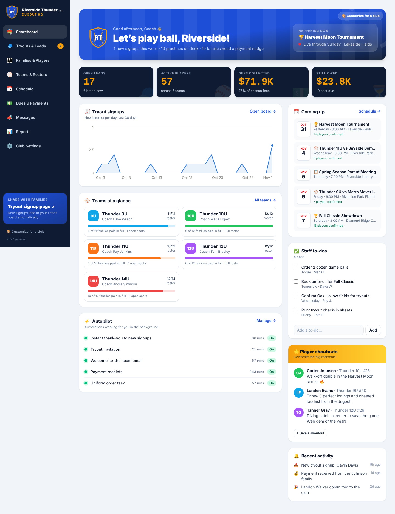
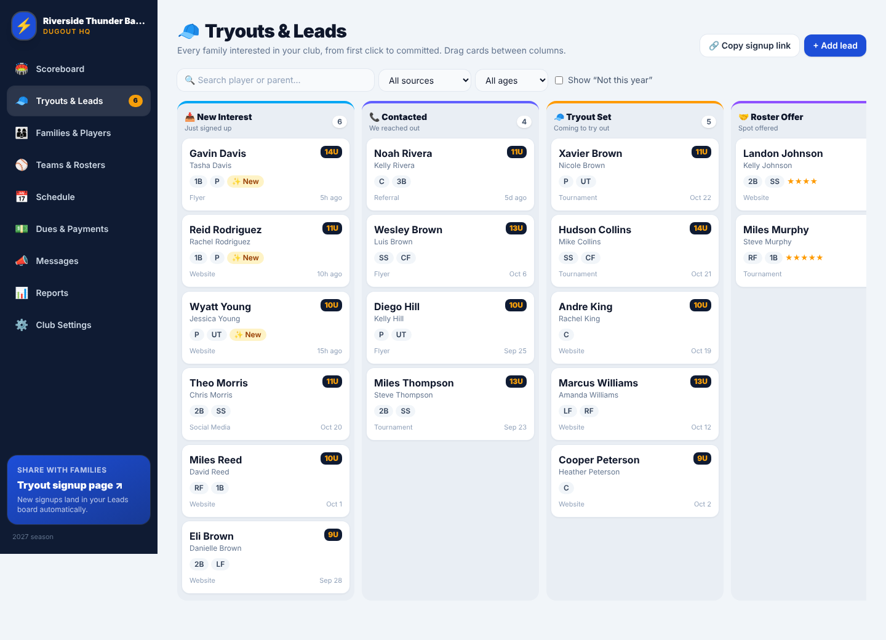
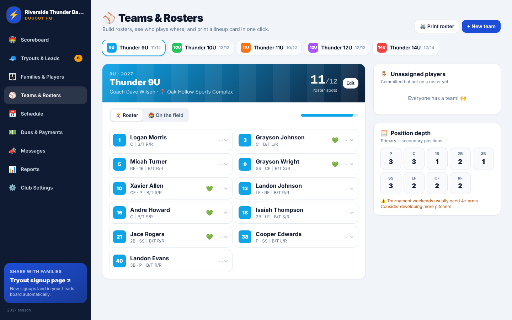
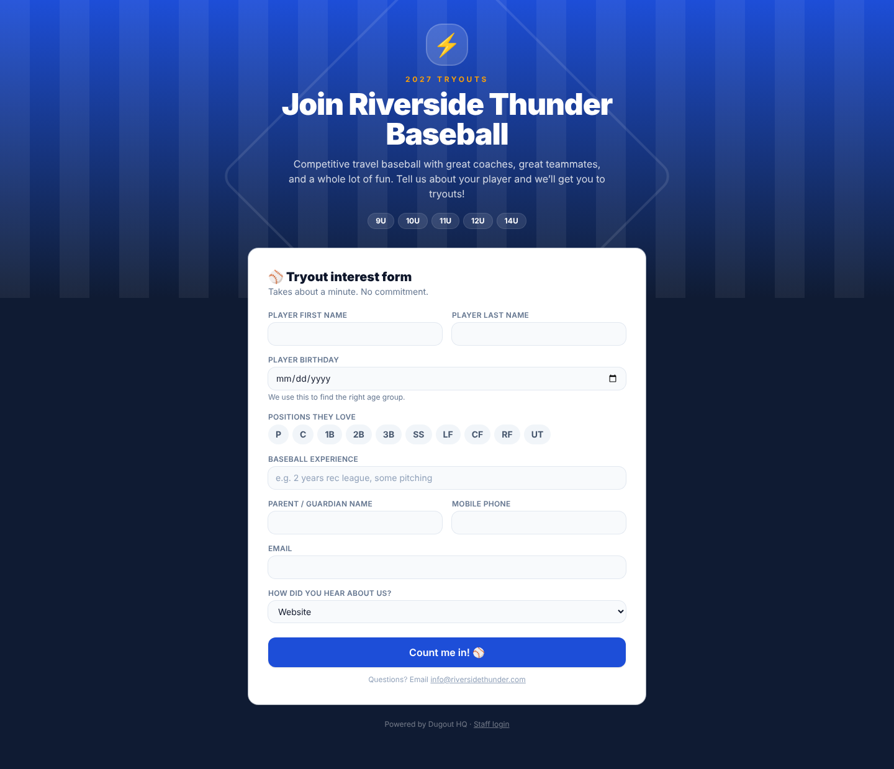
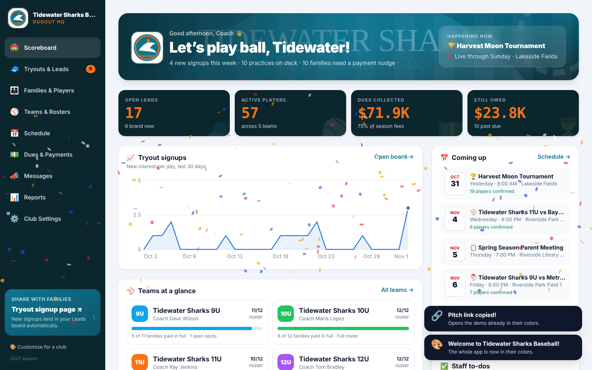

# ⚾ Dugout HQ: club operations for travel baseball

**Run your club. All in one place.** Dugout HQ gives a travel baseball organization one friendly
system for tryout leads, families, rosters, schedules, dues, and parent communication, so
coaches can spend their time coaching.

It ships with a fully loaded demo club ("Riverside Thunder Baseball": 5 teams, 57 players, live
leads, tournaments, and payment plans), so you can show it to a prospective club in under a minute.



| Tryouts & Leads | Teams & Rosters | Parent signup |
|---|---|---|
|  |  |  |

## 🎨 Customize it for any club in 30 seconds

Before a pitch meeting, click **🎨 Customize for a club** (dashboard, sidebar, or Settings) and paste
the club's website. Dugout HQ reads the site and dresses the whole app in that club's brand:

- **Name** from the site (`og:site_name`, structured data, or a cleaned-up page title)
- **Logo** from the header image, structured data, or icons (picked by score)
- **Colors** from the logo's pixels, snapped to the exact hex codes the site declares (theme-color, CSS),
  then adjusted so text stays readable (WCAG 4.5:1)
- **Banner photo** (the site's share image) used as header art on the dashboard and signup page
- **Mascot** guessed from the name (Sharks 🦈, Hurricanes 🌪️, Thunder ⚡ …) and the contact email
- **Team names**: demo teams become "*Tidewater Sharks 9U, 10U …*" across rosters, schedule, and messages

You can adjust everything in a live preview before applying. No logo? Every club gets a generated
shield crest in its colors with its initials.

**Facebook or Instagram only?** Those sites block lookups. Switch to **From a logo or screenshot**
and drop, choose, or paste (Ctrl/⌘+V) a screenshot of their logo or banner. This runs fully in the browser.

**Pitch links:** after a website lookup, **🔗 Copy pitch link** gives you
`https://your-app/#/?brand=their-site.com`. Whoever opens it sees the demo already in their colors.



## What's inside

| Area | What it does |
|---|---|
| 🏟️ **Scoreboard** | Scoreboard-style KPIs, a countdown to the next tournament, signup trend, team roster fill, staff to-dos, player shoutouts, and an activity feed |
| 🧢 **Tryouts & Leads** | Drag-and-drop pipeline (New → Contacted → Tryout Set → Roster Offer → Committed), auto age group plus best-fit team, star ratings, tryout session assignment, one-click **Commit** |
| 🔗 **Public signup page** (`#/join`) | Branded, mobile-first tryout form for parents. Shows their age group live as they type the birthday. New signups land on the Leads board automatically |
| 👨‍👩‍👦 **Families & Players** | One database for every contact, position, B/T, uniform size, and medical note. Siblings grouped by family. CSV export |
| ⚾ **Teams & Rosters** | Roster cards with jersey numbers, an **"On the field"** diamond view, position-depth warnings (e.g. not enough arms), auto-place unassigned players, printable roster |
| 📅 **Schedule** | Practices (repeat weekly), games, tournaments with hotel blocks, tryouts, fundraisers, and meetings. Per-player RSVPs. Export to Google, Apple, or Outlook (`.ics`) |
| 💵 **Dues & Payments** | Season fees, discounts, fundraising credits, payment plans (full / 3-pay / monthly), installment schedules, **past-due detection**, one-click friendly reminders |
| 📣 **Messages** | Templates with merge fields (`{{parentFirst}}`, `{{playerFirst}}`, `{{balance}}`, `{{nextDue}}`…), audience targeting (team, everyone, unpaid, open leads), live per-family preview |
| ⚡ **Automations** | Thank-you on signup, tryout invite, commit → family + registration + welcome email + uniform task, payment receipts. Each can be toggled on or off |
| 📊 **Reports** | Revenue by team (collected vs owed), monthly collections, recruiting funnel, lead-source conversion. CSV export |
| 🔄 **Season rollover** | Previews and then moves every player up to their new age group, creates new registrations, and graduates players who aged out |
| ⚙️ **Settings** | Club name, mascot, colors (the whole app re-themes), age-cutoff rule (USSSA Apr 30 by default), templates, JSON backup and restore, start a fresh club |

The fun parts: confetti when a player commits or a family pays in full, scoreboard digits,
baseball-flavored toasts ("Safe at home! 🏠"), shoutouts, and a club-colored theme everywhere.

## Run it

```bash
npm install
npm run dev        # http://localhost:5173
npm test           # business-logic tests (age groups, payments, automations, rollover)
npm run build      # static site in dist/
```

### Deploying

**Recommended: Vercel (free tier).** Import the repo at vercel.com. It detects Vite, serves `dist/`,
and runs `api/brand.ts` as the serverless website-lookup endpoint. No configuration needed.

**GitHub Pages** (`.github/workflows/deploy.yml`, enable *Settings → Pages → Source: GitHub Actions*)
hosts static files only. Everything works except the website lookup: the wizard tells you this and
offers logo upload instead. To get website lookup on Pages, deploy `api/brand.ts` anywhere (Vercel,
Netlify, Cloudflare) and build with `VITE_BRAND_API=https://your-function-host/api/brand`.

The lookup endpoint only fetches public http(s) addresses. It blocks localhost, private, and
cloud-metadata IPs (re-checked on every redirect), caps download sizes, and times out after 9 seconds.

## How it's built

- React 19 + TypeScript + Vite + Tailwind CSS v4, with Zustand for state
- `src/lib/types.ts`: the data model (teams, families, players, leads, events, registrations, messages…)
- `src/lib/ops.ts`: pure business operations and automations, unit-tested in `src/lib/core.test.ts`
- `src/lib/utils.ts`: baseball-age math, installment schedules, past-due logic, template merging
- `src/lib/seed.ts`: the demo club (dates are relative to today, so it always looks live)
- `src/lib/brand.ts`: palette extraction, theme picking with contrast fixes, team renaming (`applyBrand`)
- `server/extract.ts` + `server/brandLookup.ts`: website → brand kit (name, logo, banner, colors), with SSRF protection
- `api/brand.ts`: the serverless endpoint (also served by `npm run dev` / `npm run preview` via a Vite plugin)
- `src/pages/*`: one file per screen

## Current limits (and the path to production)

This version is **local-first**: each browser keeps its own copy of the data (localStorage), and
**emails are personalized and logged, not delivered**. That's ideal for demos and pilots. Before
charging a club for production use, add:

1. **Hosted database + logins.** Move `ClubData` to Supabase or Postgres (the shapes in
   `types.ts` map 1:1 to tables) and add staff accounts and roles (admin, coach, treasurer).
2. **Email/SMS delivery.** Send the messages `ops.ts` already produces through Resend, Postmark,
   SendGrid, or Twilio.
3. **Online payments.** Stripe Checkout or Payment Links for each installment, with a webhook
   that calls `recordPayment`.
4. **Parent portal.** A read-only team page for schedules, RSVPs, and balances.
5. **Data import.** A CSV importer for clubs moving off spreadsheets or other platforms.
